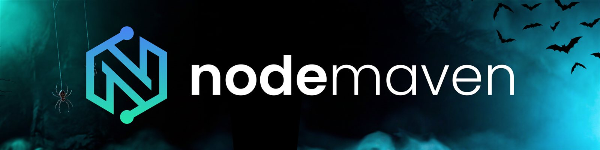

# ProxyBridge

<p align="center">
  
</p>

<p align="center">
  <a href="https://github.com/InterceptSuite/ProxyBridge/actions/workflows/build-windows.yml"></a>
  <a href="https://github.com/InterceptSuite/ProxyBridge/actions/workflows/build-mac.yml"></a>
  <a href="https://github.com/InterceptSuite/ProxyBridge/actions/workflows/build-linux.yml"></a>
  <a href="https://github.com/InterceptSuite/ProxyBridge/releases"></a>
</p>

<p align="center">
  <a href="https://trendshift.io/repositories/19916?utm_source=trendshift-badge&amp;utm_medium=badge&amp;utm_campaign=badge-trendshift-19916" target="_blank" rel="noopener noreferrer"></a>
  &nbsp;
  <a href="https://trendshift.io/repositories/19916?utm_source=trendshift-badge&amp;utm_medium=badge&amp;utm_campaign=badge-trendshift-19916" target="_blank" rel="noopener noreferrer"></a>
</p>

ProxyBridge is a free, open-source proxy client (Proxifier alternative) for **Windows**, **macOS** and **Linux**. It forces the applications you choose to use a SOCKS5 or HTTP proxy for their TCP and UDP traffic, even apps with no proxy settings or that ignore them, with no changes to the app.

> [!TIP]
> **ProxyBridge routes your traffic - [InterceptSuite](https://interceptsuite.com) lets you see inside it.**
> Full MITM proxy with SSL/TLS inspection, live request editing, scripting, and support for TCP, UDP, StartTLS, DTLS, QUIC and more. Built by the same team. [**Try InterceptSuite →**](https://interceptsuite.com)

## Table of Contents

- [Download](#download)
- [Features](#features)
- [Screenshots](#screenshots)
- [InterceptSuite](#interceptsuite)
- [License](#license)
- [Author](#author)
- [Credits](#credits)

<p align="center">
  <strong>💖 Support ProxyBridge Development</strong><br/>
  <em>If you find ProxyBridge useful, consider sponsoring to support ongoing development and new features!</em><br/><br/>
  <a href="https://github.com/sponsors/InterceptSuite">
    
  </a>
</p>

<p align="center">
  <sub>Sponsored</sub><br/>
  <a href="https://go.nodemaven.com/proxybridgeoct">
    
  </a>
</p>

[**NodeMaven**](https://go.nodemaven.com/proxybridgeoct): The most efficient proxy provider for Web Scraping and Automation with the Highest Quality IP on the market.

**Why NodeMaven?**

- ZIP targeting
- 99.9% uptime
- IP filtering: all proxies have fraud score <97%
- No KYC required
- Unique free tools: Proxy Bandwidth Checker, Meta Tag Checker, IP Lookup and others!

**Special codes for ProxyBridge users:**

- `PB2X` - 2X traffic for Black Friday
- `PB35` - 35% off Mobile and Residential Proxies
- `PB25` - 25% off ISP (Static) Proxies

## Download

<p align="center">
  <a href="https://proxybridge.interceptsuite.com/download/"></a>
  &nbsp;
  <a href="https://proxybridge.interceptsuite.com/docs/"></a>
  <br/>
  <sub>Windows, macOS and Linux (x64 and arm64). Older versions: <a href="https://github.com/InterceptSuite/ProxyBridge/releases">GitHub Releases</a>. Per-platform guides: <a href="Windows/README.md">Windows</a>, <a href="MacOS/README.md">macOS</a>, <a href="Linux/README.md">Linux</a></sub>
</p>

**macOS (Homebrew):**

```bash
brew install --cask proxybridge
```

**Linux (one-command install):**

```bash
curl -Lo deploy.sh https://raw.githubusercontent.com/InterceptSuite/ProxyBridge/refs/heads/master/Linux/deploy.sh && sudo bash deploy.sh
```

## Features

- **Per-process routing** - send traffic from chosen applications through SOCKS5 or HTTP proxies, or direct, or block it
- **Works with proxy-unaware apps** - system-level interception, no changes to the application
- **TCP and UDP** - HTTP/HTTPS, HTTP/3, SSH, RDP, databases, games, DTLS, DNS and more
- **Flexible rules** - match processes, IPs, ports, protocols and host names, with wildcards and IPv4/IPv6
- **GUI and CLI** on Windows, macOS and Linux, with profiles and rule import/export

> [!CAUTION]
> **Beware of fake ProxyBridge downloads.** Some unofficial sites distribute malware under the ProxyBridge name. Download only from this repository or [interceptsuite.com/download/proxybridge](https://proxybridge.interceptsuite.com/download/), or build from source. ProxyBridge contacts no server except its update feed (`download.interceptsuite.com/proxybridge.json`), on launch or when you check for updates.

## Screenshots

- [macOS screenshots](MacOS/README.md#overview)
- [Windows screenshots](Windows/README.md#usage)
- [Linux screenshots](Linux/README.md#gui-application)
- [iOS screenshots](iOS/README.md#screenshots)

## InterceptSuite

ProxyBridge is a **proxy client** - it routes your application traffic through any SOCKS5 or HTTP proxy. It does not inspect or modify the traffic itself.

**[InterceptSuite](https://interceptsuite.com)** is a **MITM SOCKS5 proxy server** built for traffic interception and analysis. Point ProxyBridge at InterceptSuite and you can inspect everything:

- Full TLS/SSL interception and certificate spoofing
- TCP, UDP, StartTLS, DTLS traffic analysis
- Live request and response editing
- Scripting and automation

ProxyBridge routes the traffic in. InterceptSuite sees inside it.

[**Try InterceptSuite →**](https://interceptsuite.com)

## License

MIT License - See LICENSE file for details

## Author

Sourav Kalal ([X](https://x.com/Ano_F_), [LinkedIn](https://www.linkedin.com/in/sourav-kalal/)) / InterceptSuite ([X](https://x.com/InterceptSuite), [LinkedIn](https://www.linkedin.com/company/interceptsuite/))

## Credits

**Windows Implementation:**
This project is built on top of [WinDivert](https://reqrypt.org/windivert.html) by basil00. WinDivert is a powerful Windows packet capture and manipulation library that makes kernel-level packet interception possible. Special thanks to the WinDivert project for providing such a robust foundation.

Based on the StreamDump example from WinDivert:
https://reqrypt.org/samples/streamdump.html

The Windows GUI and CLI are written in native C using the Win32 API, keeping the footprint small and startup instant.

**macOS Implementation:**
Built using Apple's Network Extension framework for transparent proxy capabilities on macOS.

**Linux Implementation:**
Built on eBPF with a GTK3 GUI. See [Linux/README.md](Linux/README.md).

**iOS Implementation:**
Built on a Network Extension packet tunnel. The packet stack that turns the device's packets into TCP connections and UDP flows is [hev-socks5-tunnel](https://github.com/heiher/hev-socks5-tunnel) by heiher (MIT licence), which includes lwIP and other open-source libraries. Special thanks to the hev-socks5-tunnel project. See [iOS/README.md](iOS/README.md).

**Android Implementation:**
Built on the Android `VpnService`. The packet stack that turns the device's packets into TCP connections and UDP flows is [hev-socks5-tunnel](https://github.com/heiher/hev-socks5-tunnel) by heiher (MIT licence), which includes lwIP and other open-source libraries. Special thanks to the hev-socks5-tunnel project. See [Android/README.md](Android/README.md).
