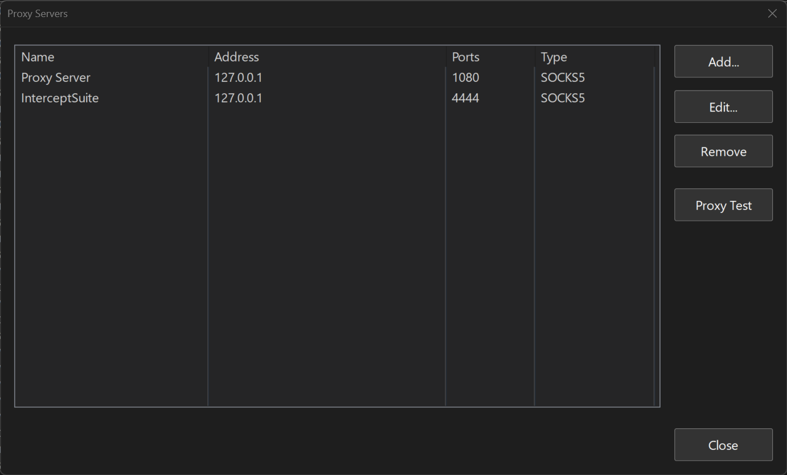
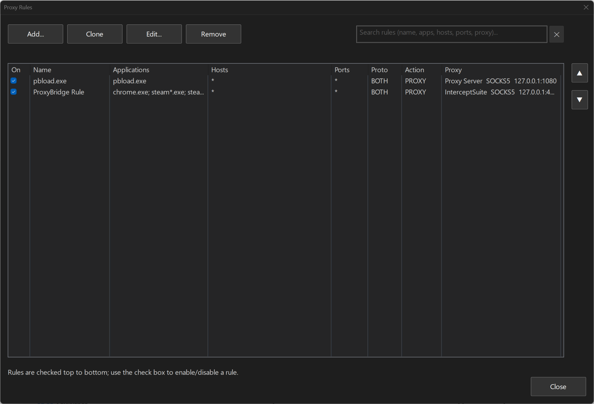
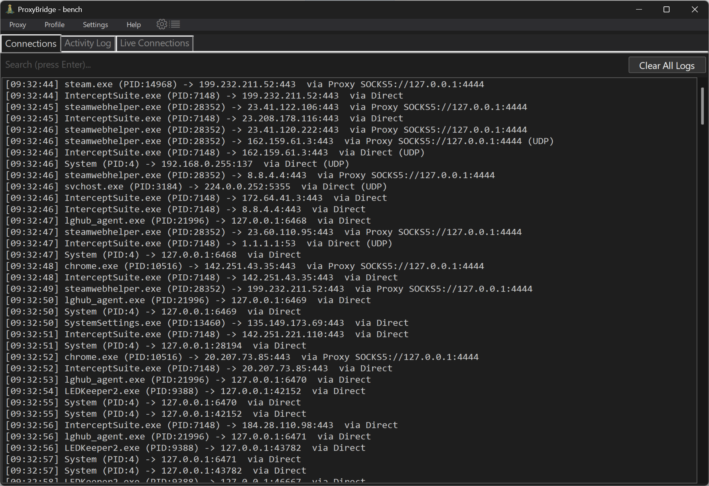
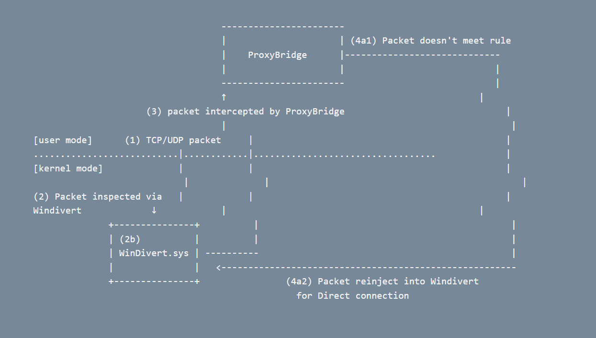
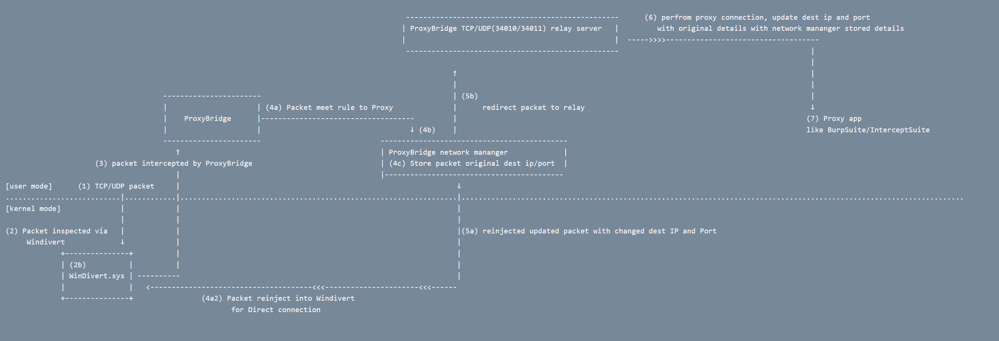

# ProxyBridge for Windows

Universal proxy client for Windows applications - route any application through SOCKS5/HTTP proxies without modifying the application.

> **ProxyBridge is a proxy client - it routes your traffic. [InterceptSuite](https://interceptsuite.com) is the MITM SOCKS5 proxy server that lets you inspect it.**
> Point ProxyBridge at InterceptSuite to intercept TCP, UDP, StartTLS, DTLS and TLS traffic from any application. [**Try InterceptSuite →**](https://interceptsuite.com)

## Table of Contents

- [ProxyBridge for Windows](#proxybridge-for-windows)
  - [Table of Contents](#table-of-contents)
  - [Installation](#installation)
  - [Usage](#usage)
    - [GUI Application](#gui-application)
      - [Proxy Settings](#proxy-settings)
      - [Multiple Proxy Configurations](#multiple-proxy-configurations)
      - [Process Rules](#process-rules)
      - [Exporting and Importing Rules](#exporting-and-importing-rules)
      - [Activity Monitoring](#activity-monitoring)
    - [Command Line Interface (CLI)](#command-line-interface-cli)
      - [Profile Format](#profile-format)
      - [Basic Usage](#basic-usage)
      - [Command Line Options](#command-line-options)
  - [Use Cases](#use-cases)
  - [Things to Note](#things-to-note)
  - [How It Works](#how-it-works)
  - [Build from Source](#build-from-source)
    - [Requirements](#requirements)
    - [Using the PowerShell Build Script (Recommended)](#using-the-powershell-build-script-recommended)
    - [Manual Build - DLL (MSVC)](#manual-build---dll-msvc)
    - [Manual Build - DLL (GCC / MinGW-w64)](#manual-build---dll-gcc--mingw-w64)
    - [Manual Build - CLI (MSVC)](#manual-build---cli-msvc)
  - [InterceptSuite](#interceptsuite)
  - [License](#license)

## Installation

1. Download the latest `ProxyBridge-Setup-X.X.X.exe` from the [Releases](https://github.com/InterceptSuite/ProxyBridge/releases) page
2. Run the installer with Administrator privileges
3. The installer will:
   - Install ProxyBridge to `C:\Program Files\ProxyBridge`
   - Add the install directory to your system PATH (GUI, CLI, and DLL all accessible)
   - Create Start Menu shortcuts for the GUI application
   - Include all required dependencies (WinDivert driver)


## Usage

### GUI Application

Launch `ProxyBridge.exe` with Administrator privileges for an intuitive graphical interface.

#### Proxy Settings

<p align="center">
  
</p>

1. Click **Proxy** tab in the main window
2. Click **Proxy Settings** from the menu
3. Select **Proxy Type** (SOCKS5 or HTTP)
4. Enter **Proxy Host** - supports both IP addresses and domain names:
   - IP Address: `127.0.0.1`, `192.168.1.100`
   - Domain Name: `proxy.example.com`, `localhost`
5. Enter **Proxy Port** (e.g., 1080 for SOCKS5, 8080 for HTTP)
6. (Optional) Enter **Proxy Username** and **Proxy Password** for authenticated proxies
7. Click **Save Changes**

**Test Proxy Connection:**
1. Click **Test Proxy Connection** button
2. Enter **Destination IP/Host** (default: google.com)
3. Enter **Destination Port** (default: 80)
4. Click **Start Test** to verify proxy connectivity

#### Multiple Proxy Configurations

ProxyBridge supports multiple proxy server configurations simultaneously. Each proxy rule can be assigned to a specific proxy configuration, allowing you to route different applications through different proxies at the same time.

- Add multiple proxy servers (SOCKS5 and HTTP, mixed) in **Proxy Settings**
- Each proxy entry gets a unique ID
- When creating a **Proxy Rule**, select which proxy configuration to route through via the **Proxy Config** selector
- If a rule's assigned proxy config is not found, ProxyBridge falls back to the first available configuration

**Example use cases:**
- Route `chrome.exe` through a SOCKS5 proxy and `curl.exe` through an HTTP proxy simultaneously
- Test against multiple proxy endpoints without restarting
- Assign latency-sensitive apps to a local proxy and others to a remote one

#### Process Rules

<p align="center">
  
</p>

1. Click **Proxy** tab in the main window
2. Click **Proxy Rules** from the menu
3. Configure rule parameters:

   **Applications:**
   - Use `*` as wildcard for all processes
   - Enter single process: `chrome.exe`
   - Enter multiple processes (semicolon-separated): `firefox.exe; chrome.exe`
   - Use **Browse** button to select a process executable

   **Target Hosts (Optional):**
   - Specific IP: `192.168.1.1`
   - Wildcard IP range: `192.168.*.*`
   - Multiple IPs: `127.0.0.1; 192.168.1.1`
   - IP range: `10.10.1.1-10.10.255.255`
   - IPv4 CIDR: `10.0.0.0/8`, `192.168.1.128/25`
   - IPv6 exact: `::1`, `2001:db8::1`
   - IPv6 CIDR: `2001:db8::/32`, `fe80::/10`
   - IPv6 range: `2001:db8::1-2001:db8::ff`
   - Domain names: `github.com`, `*.github.com`
   - Leave empty or use `*` for all hosts

   IP addresses and domain names go in the **same** field and can be mixed: `10.*.*.*; github.com; *.google.com`
   matches a connection when its IP matches an IP entry **or** its domain matches a domain entry. The box is
   multiline, so a long list can be written one entry per line; line breaks are only for readability and
   `;` separates the entries (up to 8191 characters).

   Domain names are learned from the application's own DNS lookups, so they only work with unencrypted DNS
   (turn off "Secure DNS" / DNS over HTTPS in the browser). In profile files the entries are saved as
   `TargetHosts` (IPs) and `TargetDomains` (domain names), which other ProxyBridge apps read the same way.

   **Target Ports (Optional):**
   - Specific ports: `80; 8080`
   - Port range: `80-8000`
   - Leave empty or use `*` for all ports

   **Protocol:**
   - Select **TCP**, **UDP**, or **Both (TCP + UDP)**

   **Action:**
   - **PROXY** - Route through the selected proxy configuration
   - **DIRECT** - Allow direct internet access
   - **BLOCK** - Block all internet access

4. Click **Save Rule** to apply

#### Exporting and Importing Rules

ProxyBridge allows you to export selected rules to a `.pbprofile` JSON file and import rules from previously exported files.

**Export Rules:**
1. In the **Proxy Rules** window, select one or more rules using the checkboxes
2. Click the **Export** button
3. Choose a location and save the file (`.pbprofile`)

**Import Rules:**
1. Click the **Import** button
2. Select a previously exported `.pbprofile` file
3. Rules and proxy configurations are imported and merged with existing settings

**Profile JSON Format:**
```json
{
  "Version": "1.0",
  "IsTrafficLoggingEnabled": true,
  "ProxyConfigs": [
    {
      "Id": 1,
      "Type": "socks5",
      "Host": "127.0.0.1",
      "Port": "1080",
      "Username": "",
      "Password": ""
    },
    {
      "Id": 2,
      "Type": "http",
      "Host": "127.0.0.1",
      "Port": "8080",
      "Username": "",
      "Password": ""
    }
  ],
  "ProxyRules": [
    {
      "ProcessName": "chrome.exe",
      "TargetHosts": "*",
      "TargetPorts": "*",
      "Protocol": "TCP",
      "Action": "PROXY",
      "IsEnabled": true,
      "LocalhostViaProxy": false,
      "ProxyConfigId": 1
    },
    {
      "ProcessName": "firefox.exe",
      "TargetHosts": "192.168.*.*",
      "TargetPorts": "80;443",
      "Protocol": "BOTH",
      "Action": "PROXY",
      "IsEnabled": true,
      "LocalhostViaProxy": false,
      "ProxyConfigId": 2
    }
  ]
}
```

**Note:** The `.pbprofile` format is cross-platform - profiles exported from macOS can be imported on Windows and vice versa.

#### Activity Monitoring

<p align="center">
  
</p>

<p align="center">
  
</p>

- View real-time connection activity in the **Connections** tab
- See what is relayed right now in the **Live Connections** tab: one row per proxied TCP connection or UDP flow with the
  application, target, time, proxy and bytes sent / received. A finished connection turns grey and stays in the list
  (with its final byte counts) until you press **Clear closed**; the list keeps up to 1200 rows and replaces the oldest finished
  one when full. Direct and blocked traffic is not listed (ProxyBridge only sees the first packet of those). The tab polls once
  a second, and only while it is open.
- Monitor all TCP and UDP connections system-wide
- See routing status per connection: **PROXY**, **DIRECT**, or **BLOCK**
- Search and filter by process name, IP, port, or routing status

**Searching a long rule list:** the **Proxy Rules** window has a search box at the top right. The list shows only
the rules that contain **every** word you type (case-insensitive) in their name, applications, hosts, ports,
protocol, action or proxy, for example `chrome github` or `192.168 proxy`. Press **Ctrl+F** to jump to the box,
just start typing while the list has focus, **Enter** or **Down** to go to the matching rules, and **Esc** (or the
**x** button) to clear the search. Edit, Clone, Remove and the enable check boxes work on the rules you see;
Move Up / Move Down are only available when no search is active, because the order of a partial list is ambiguous.

**Pausing ProxyBridge (main switch):** untick **Proxy → Enable ProxyBridge** (or right-click the tray icon and untick
**Enable ProxyBridge**) to switch every rule off without closing the app. While paused, new connections go out
directly: proxy rules **and block rules** do not apply, and the window title and tray tooltip show "(PAUSED)".
Connections that were already being proxied keep working until they end. Tick the item again to apply the rules
to new connections. ProxyBridge always starts enabled; the switch is not remembered between runs.

**Connections log - one row per connection or per destination:** by default the Connections log shows a connection
only once for each identical (application, destination IP, destination port, action), which keeps it short: an app
that opens 50 connections to the same server gets one row. Tick **Settings → Log Every Connection** to log **every new
TCP connection** and **every new UDP flow** instead (a UDP flow is one local port talking to one destination; it is
logged again only after 30 seconds of silence, so busy or blocked UDP senders do not flood the log). The setting is
saved per profile. It only changes what is listed: rules are applied to the same connections either way.

**Note:** Adding a rule with action **PROXY** while no proxy is configured will fall back to a direct connection. Configure at least one proxy server before using PROXY rules.

### Command Line Interface (CLI)

`ProxyBridge_CLI.exe` is a lightweight native CLI that loads a `.pbprofile` exported from the GUI and runs ProxyBridge headlessly - no GUI required.

#### Profile Format

The CLI reads `.pbprofile` files exported directly from the GUI (**Profile → Export Profile**). These are JSON files containing proxy server configurations and routing rules. See the [Profile JSON Format](#exporting-and-importing-rules) section above for the schema.

**Key profile fields read by the CLI:**

| Field | Description |
|---|---|
| `ProxyConfigs[]` | Array of proxy servers (SOCKS5 or HTTP, up to 32) |
| `ProxyRules[]` | Array of routing rules (up to 256) |
| `ProxyRules[].LocalhostViaProxy` | Per rule: also proxy `127.x.x.x` / `::1` traffic that matches this rule (default `false`) |
| `IsTrafficLoggingEnabled` | Enable/disable connection logging |
| `ProxyConfigId` | Per-rule proxy assignment (maps to `ProxyConfigs[].Id`) |

#### Basic Usage

```powershell
# Run a profile (requires Administrator)
ProxyBridge_CLI.exe --profile C:\Users\user\myconfig.pbprofile

# Run with connection logging
ProxyBridge_CLI.exe --profile myconfig.pbprofile --verbose 2

# Run with full log and connection output
ProxyBridge_CLI.exe --profile myconfig.pbprofile --verbose 3

# Check for updates (does not require Administrator)
ProxyBridge_CLI.exe --update

# Show version
ProxyBridge_CLI.exe --version

# Show help
ProxyBridge_CLI.exe --help
```

#### Command Line Options

```
  ____                        ____       _     _
 |  _ \ _ __ _____  ___   _  | __ ) _ __(_) __| | __ _  ___
 | |_) | '__/ _ \ \/ / | | | |  _ \| '__| |/ _` |/ _` |/ _ \
 |  __/| | | (_) >  <| |_| | | |_) | |  | | (_| | (_| |  __/
 |_|   |_|  \___/_/\_\__, | |____/|_|  |_|\__,_|\__, |\___|
                     |___/                       |___/  V4.0.0

  Universal proxy client for Windows applications

Options:
  --profile <path>     Path to .pbprofile file exported from the GUI
                       Export from GUI: Profile > Export Profile

  --verbose <0-3>      Logging verbosity
                         0 - Silent (default)
                         1 - Log messages only
                         2 - Connection events only
                         3 - Both logs and connections

  --version            Show version information
  -?, -h, --help       Show help

Commands:
  --update             Check for updates and download latest installer from GitHub
                       (does not require Administrator)
```

**Notes:**
- `--profile` requires Administrator (WinDivert kernel driver)
- `--update` and `--version` do not require Administrator
- Press `Ctrl+C` to stop ProxyBridge cleanly
- The CLI and `ProxyBridgeCore.dll` must be in the same directory

## Use Cases

- Redirect proxy-unaware applications (games, desktop apps) through InterceptSuite/Burp Suite for security testing
- Route specific applications through Tor, SOCKS5, or HTTP proxies
- Intercept and analyze traffic from applications that don't support proxy configuration
- Route different applications through different proxy servers simultaneously
- Test application behavior under different network conditions
- Analyze IPv4 and IPv6 protocols and communication patterns


## Things to Note

- **Localhost Traffic Handling**: Localhost traffic (`127.0.0.0/8` and IPv6 `::1`) is handled **per rule** with the **Also proxy localhost traffic** checkbox in the rule editor (off by default):

  **Default Behavior (checkbox off):**
  - Connections to localhost that match the rule are sent directly, not through the proxy
  - Other traffic from the same application still follows the rule as usual
  - This is the recommended setting for most rules

  **Why localhost should stay local:**
  - **Security**: Most proxy servers reject localhost traffic to prevent SSRF (Server-Side Request Forgery) attacks
  - **Compatibility**: Many applications run local services that must stay on your machine:
    - NVIDIA GeForce Experience (local API servers)
    - Chrome/Edge DevTools (`127.0.0.1:9222` debugging protocol)
    - Development servers (localhost web/database servers)
    - Inter-process communication (IPC) using TCP/UDP on `127.0.0.1`
  - **Routing Issues**: When localhost traffic goes to a remote proxy, the proxy server cannot reach services running on YOUR machine

  **When to tick "Also proxy localhost traffic" on a rule:**
  - ✅ Proxy server is running on the same machine (`127.0.0.1:1080`)
  - ✅ Security testing: Intercepting that application's localhost traffic in Burp Suite/InterceptSuite
  - ✅ Your proxy is configured to handle localhost requests properly
  - ❌ Do NOT tick it if the proxy is on a different machine/IP address

  Because the setting belongs to the rule, you can proxy localhost traffic for one application (for example your browser) while another (for example `curl.exe`) keeps its local connections direct.

  **CLI / profiles:** Controlled by the `LocalhostViaProxy` field of each rule in the `.pbprofile` file. Older profiles with a single global `LocalhostViaProxy` are still read; that value becomes the default for rules that have no setting of their own.

- **Automatic Direct Routing**: Certain addresses and ports always bypass proxy rules and use direct connection to preserve network stability:

  **IPv4:**
  - **Broadcast** (`255.255.255.255` and `x.x.x.255`) - Network broadcast
  - **Multicast** (`224.0.0.0–239.255.255.255`) - Group communication
  - **APIPA / Link-local** (`169.254.0.0/16`) - Automatic Private IP Addressing
  - **DHCP ports** (UDP 67, 68) - Dynamic Host Configuration Protocol

  **IPv6:**
  - **Multicast** (`FF00::/8`) - Replaces IPv4 broadcast entirely; includes DHCPv6 multicast (`FF02::1:2`), all-nodes (`FF02::1`), router solicitation, etc.
  - **Link-local** (`FE80::/10`) - Cannot be routed off-link; equivalent to IPv4 APIPA
  - **Site-local (deprecated)** (`FEC0::/10`) - Still seen on older equipment
  - **Unspecified** (`::`) - Equivalent to IPv4 `0.0.0.0`
  - **DHCPv6 ports** (UDP 546, 547) - Dynamic Host Configuration Protocol for IPv6

  You can still create rules with **DIRECT** or **BLOCK** actions targeting these addresses/ports to explicitly log or block such traffic, but **PROXY** is always overridden to **DIRECT** for them.

- **IPv6 Support**: ProxyBridge fully supports IPv6 traffic interception and routing for both TCP and UDP. IPv6 rules use the same format as IPv4 with additional notation:
  - Exact address: `::1`, `2001:db8::1`
  - CIDR: `2001:db8::/32`, `fe80::/10`
  - Range: `2001:db8::1-2001:db8::ff`
  - Wildcard `*` matches all IPv4 and IPv6 addresses

- **UDP Proxy Requirements**: UDP traffic only works when a SOCKS5 proxy is configured. HTTP proxies cannot relay UDP traffic - ProxyBridge will automatically fall back to direct for UDP when only an HTTP proxy is configured.

  **Important UDP Considerations**:
  - Most SOCKS5 proxies do not support UDP ASSOCIATE (including SSH SOCKS5 tunnels)
  - The SOCKS5 proxy must support the UDP ASSOCIATE command
  - Many UDP applications use HTTP/3 and DTLS protocols - ensure your proxy handles these
  - **Testing**: Try [Nexus Proxy](https://github.com/InterceptSuite/nexus-proxy) to test ProxyBridge UDP/HTTP3/DTLS support

- **Multiple Proxy Configurations**: Up to 32 proxy server configurations can be active simultaneously. Rules can each be assigned to a specific proxy config. If the assigned config is not found, ProxyBridge falls back to the first available config. This allows routing different apps through different proxies without any application-side configuration.

## How It Works

ProxyBridge use Windivert to inspect all TCP/UDP packets and use rules from user to perform action on them

Case 1: Packet does not match any rules

<p align="center">
  
</p>


Case 2: Packet match with proxy rule


<p align="center">
  
</p>

**Traffic Flow:**
1. **Applications Generate Traffic** - User-mode applications (Chrome, Discord, Games, Services) create TCP/UDP packets
2. **Kernel Interception** - WinDivert.sys driver intercepts ALL outbound packets at kernel level
3. **User-Mode Delivery** - WinDivert.dll receives intercepted packets and delivers them to ProxyBridge
4. **Rule Evaluation** - ProxyBridge inspects each packet and applies configured rules:
   - **BLOCK** → Packet is dropped (no network access)
   - **DIRECT** → Packet is re-injected unchanged (direct connection)
   - **NO MATCH** → Packet is re-injected unchanged (direct connection)
   - **PROXY** → Packet destination is modified to TCP/UDP relay servers (34010/34011)
5. **Proxy Processing** - For PROXY-matched packets:
   - Relay servers store original destination IP and port
   - Convert raw TCP/UDP to SOCKS5/HTTP proxy protocol
   - Perform proxy authentication and forward to proxy server
6. **Proxy Forwarding** - Proxy server (Burp Suite/InterceptSuite) forwards traffic to original destination
7. **Response Handling** - Return traffic flows back through relay servers, which restore original source IP/port before re-injection

**Key Points:**
- All packet manipulation happens transparently - applications remain completely unaware
- WinDivert operates at kernel level for reliable interception before packets reach the network
- ProxyBridge rule engine provides granular control over which traffic gets proxied
- TCP/UDP relay servers handle protocol conversion between raw sockets and proxy protocols


## Build from Source

### Requirements

- Windows 7 or later (64-bit)
- Administrator privileges (required for WinDivert driver)
- Visual Studio 2019 or later (MSVC - recommended) **or** MinGW-w64 (GCC)
- WinDivert 2.2.2-A or later

### Using the PowerShell Build Script (Recommended)

```powershell
cd Windows
.\compile.ps1
```

The script automatically:
- Locates your Visual Studio installation via `vswhere`
- Compiles `ProxyBridgeCore.dll` (C, MSVC, WinDivert)
- Compiles `ProxyBridge_CLI.exe` (C, MSVC, native)
- Builds `ProxyBridge.exe` (C GUI, MSVC, self-contained)
- Copies all outputs to `Windows\output\`

### Manual Build - DLL (MSVC)

```powershell
# From a Visual Studio Developer Command Prompt
cl /O2 /GL /W4 /D_WIN32_WINNT=0x0601 /DNDEBUG /GS /guard:cf ^
   /I"path\to\windivert\include" ^
   ProxyBridge.c /LD ^
   /link /LTCG /OPT:REF /RELEASE /DYNAMICBASE /NXCOMPAT ^
   WinDivert.lib ws2_32.lib iphlpapi.lib ^
   /OUT:ProxyBridgeCore.dll
```

### Manual Build - DLL (GCC / MinGW-w64)

```powershell
gcc -O2 -Wall -D_WIN32_WINNT=0x0601 -shared ^
    -I"C:\WinDivert-2.2.2-A\include" ^
    ProxyBridge.c ^
    -L"C:\WinDivert-2.2.2-A\x64" -lWinDivert -lws2_32 -liphlpapi ^
    -o ProxyBridgeCore.dll
```

### Manual Build - CLI (MSVC)

```powershell
cl /O2 /W4 /D_WIN32_WINNT=0x0601 /DNDEBUG /GS /guard:cf ^
   cli\main.c ^
   /link /RELEASE /DYNAMICBASE /NXCOMPAT /SUBSYSTEM:CONSOLE ^
   winhttp.lib shell32.lib advapi32.lib ^
   /OUT:ProxyBridge_CLI.exe
```

## InterceptSuite

ProxyBridge routes your traffic through a SOCKS5 or HTTP proxy. **[InterceptSuite](https://interceptsuite.com)** is the MITM SOCKS5 proxy server to pair it with - intercept and analyze TCP, UDP, StartTLS, DTLS, TLS traffic from any application without modifying it.

[**Try InterceptSuite →**](https://interceptsuite.com)

## License

MIT License - See LICENSE file for details
