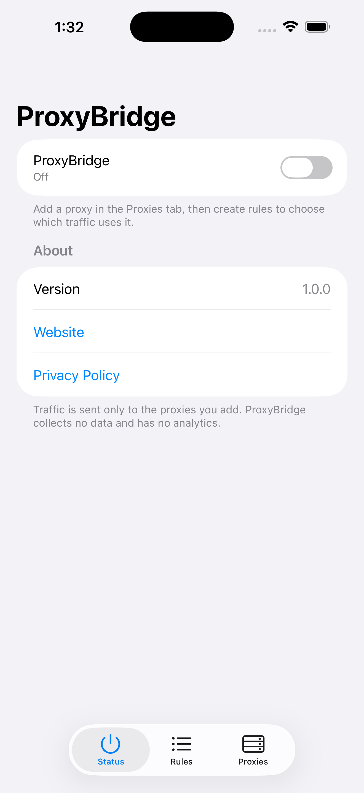
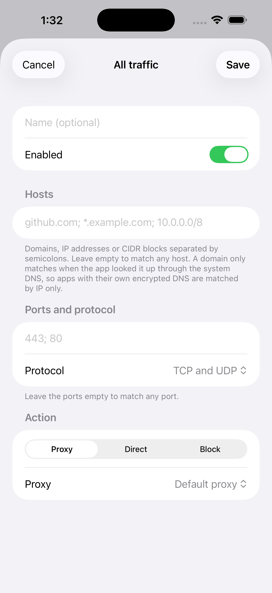
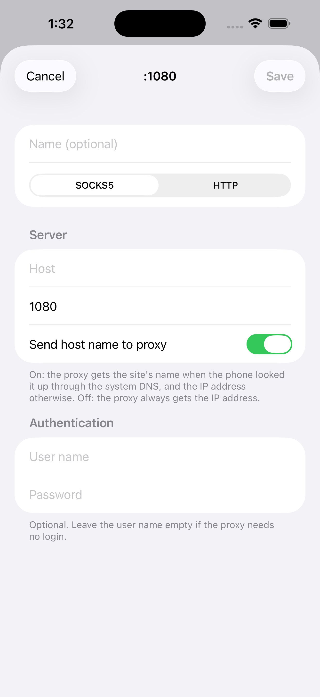

# ProxyBridge for iOS

Sends the traffic of your iPhone or iPad through a SOCKS5 or HTTP proxy. You choose per destination what goes through a proxy, what goes direct and what is blocked. The app has no analytics and collects no data.

## Screenshots

<p align="center">
  
  &nbsp;
  
  &nbsp;
  
  <br/>
  <em>Status, rule editor and proxy editor</em>
</p>

## What it does

- Proxies: SOCKS5 and HTTP (CONNECT), with optional user name and password. TCP and UDP work with SOCKS5, HTTP proxies carry TCP only.
- Per proxy, "Send host name to proxy" (on by default, like the macOS and Windows apps): when the phone looked a site up through the system DNS, the proxy is given its name instead of its IP address, which is what a tool such as InterceptSuite or Burp shows. The name is only used for five minutes after the DNS answer, and only if it is a plain host name.
- Rules: match a destination by domain (wildcards allowed), IP address or CIDR block, plus ports and protocol. The first matching rule wins and its action is proxy, direct or block.
- A default action for traffic that matches no rule. The first proxy in the list is the default proxy.
- Traffic to devices on the same Wi-Fi or local network goes through the tunnel too, so an app that controls an IoT or local network can be routed and inspected like any other.
- Changes apply to a running tunnel without turning it off.

## What it cannot do

iOS does not tell a VPN which app sent a packet, so unlike the macOS app a rule cannot name an app or process. Rules apply to the whole device and match the destination only. Per-app routing exists only for managed devices (MDM Per-App VPN).

Broadcast and multicast packets, which apps use to find devices on a network, cannot be carried by a SOCKS5 or HTTP proxy.

A domain rule needs the name to be known. ProxyBridge learns names from DNS answers, so apps that use their own encrypted DNS or connect to a fixed IP address match by IP only.

## How it works

```
all apps -> iOS packet tunnel -> hev-socks5-tunnel -> local router -> proxy / direct / block
```

The extension is a packet tunnel (`NEPacketTunnelProvider`). It receives raw IP packets, and [hev-socks5-tunnel](https://github.com/heiher/hev-socks5-tunnel) (MIT) turns them into TCP connections and UDP flows. hev sends each one as a SOCKS5 request to a router that listens on the IPv6 loopback address (`::1`) inside the extension, because hev's connection to an IPv4 address fails on iOS. The router is the only place where rules are applied:

- DNS queries are answered by forwarding them to the network's real DNS servers. The answers are read to learn which names belong to which addresses.
- Each connection or UDP flow is looked up in the rules, then relayed through the proxy, relayed directly, or refused.

The app and the extension share the config through the app group `group.com.interceptsuite.ProxyBridge`. Saving a change in the app notifies the extension, which reloads it.

```
ProxyBridge/App      SwiftUI app: status, rules, proxies
ProxyBridge/Shared   config model and storage, used by the app and the extension
ProxyBridge/Tunnel   packet tunnel provider, router, rule engine, proxy client, UDP relay, DNS
Vendor               script that builds hev-socks5-tunnel
tests                unit and end-to-end checks that run on a Mac
```

## Tests

`tests/run.sh` builds the router and the rule logic for the Mac from the real tunnel sources and runs them, with no phone and no signing. It runs unit checks, then end-to-end checks that drive the router the way hev does against local test proxies (they come from `MacOS/tests/servers.py`). The end-to-end part needs ports 1080, 1081 and 8080 free, and network access for the DNS check.

```bash
bash tests/run.sh
```

The tunnel library, the iOS VPN prompt and the extension memory limit can only be tested on a device.

## Building

Requirements: Xcode 15 or later, [XcodeGen](https://github.com/yonaskolb/XcodeGen), and an Apple Developer account. Packet tunnels do not run in the simulator, so test on a device.

1. Build the tunnel library once. It clones a pinned hev commit and produces `Vendor/HevSocks5Tunnel.xcframework`.

   ```bash
   bash Vendor/build-hev.sh
   ```

2. Set your signing team. `Signing.xcconfig` is ignored by git, so your team ID stays out of the repository.

   ```bash
   cp Signing.example.xcconfig Signing.xcconfig    # then put your Team ID in Signing.xcconfig
   xcodegen generate
   open ProxyBridge.xcodeproj
   ```

3. In the Apple Developer portal, both App IDs need the Network Extension capability (packet tunnel) and the App Groups capability with `group.com.interceptsuite.ProxyBridge`. Xcode can create these with automatic signing.

Bundle identifiers: `com.interceptsuite.ProxyBridge.ios` (app) and `com.interceptsuite.ProxyBridge.ios.tunnel` (extension).

## Data

Proxy settings, including passwords, are stored in the app group container. The file is only protected until the first unlock after a restart, because the tunnel must be able to read it while the device is locked.
